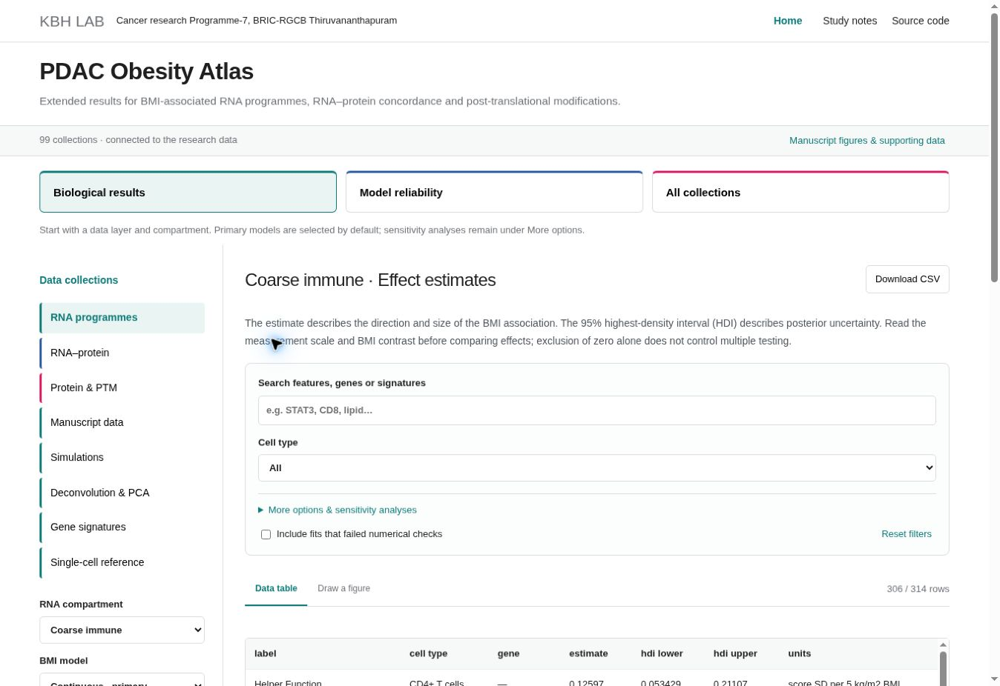

# PDAC Obesity Atlas — analysis code

Analysis code and an interactive results atlas for BMI-associated RNA programmes, RNA–protein concordance and post-translational modifications in pancreatic ductal adenocarcinoma.

**[Open the PDAC Obesity Atlas](https://kbh-lab-rgcb.github.io/models-obesity/)** · **[KBH Lab](https://kbh-lab-rgcb.github.io/)**

The atlas provides aggregate effect estimates, uncertainty intervals, model diagnostics, gene signatures, deconvolution QC, simulations and manuscript supporting data. Figures are generated from the selected database records using the study's Python plotting code.

## Analysis index

Configure the input paths and run controls in each workflow.

| Analysis | Code | Role |
| --- | --- | --- |
| Immune reference and BayesPrism deconvolution | [Notebook](analysis/deconvolution/immune_reference_deconvolution.ipynb) · [Instructions](analysis/deconvolution/README.md) | CD45+ reference preparation and coarse/fine immune deconvolution. |
| Nonimmune reference and BayesPrism deconvolution | [Notebook](analysis/deconvolution/nonimmune_reference_deconvolution.ipynb) · [Instructions](analysis/deconvolution/README.md) | Stromal/epithelial reference preparation and nonimmune deconvolution. |
| LLM-assisted signature curation | [Script](analysis/signatures/curate_signatures.py) · [Instructions](analysis/signatures/README.md) | Interactive redundancy review and proposed additions, with human approval. |
| Compartment QC and weighted PCA | [Notebook](analysis/deconvolution/compartment_qc_and_pca.ipynb) · [Instructions](analysis/deconvolution/README.md) | Audits completed BayesPrism outputs and constructs tiered and strict-QC PCA summaries. |
| Cellular RNA simulation | [Notebook](analysis/rna_simulation/cellular_rna_simulation.ipynb) · [Instructions](analysis/rna_simulation/README.md) | Synthetic-data generation and continuous/categorical fits for 20 conditions and ten datasets each. |
| Continuous BMI with low-read exclusion | [Notebook](analysis/rna/low_read_sensitivity.ipynb) | Primary RNA analyses; select each of the three compartments. |
| Continuous BMI, cell-type-specific tail parameter | [Notebook](analysis/rna/continuous_celltype_nu.ipynb) | All-profile coarse-immune comparison. |
| Continuous BMI, shared tail parameter | [Notebook](analysis/rna/continuous_global_nu.ipynb) | All-profile fine-immune and nonimmune comparisons. |
| Categorical BMI | [Notebook](analysis/rna/categorical_bmi.ipynb) | Descriptive three-group contrasts and patient-influence analysis. |
| Read-dependent residual scale | [Notebook](analysis/rna_extension/read_dependent_scale.ipynb) · [Instructions](analysis/rna_extension/README.md) | Six sensitivity fits: three compartments, each with filtered and all eligible profiles. |
| Paired RNA–protein | [Notebook](analysis/paired/rna_protein_paired.ipynb) | Joint models, sensitivity analyses and paired within-plex bootstrap. |
| Paired protein–PTM | [Notebook](analysis/paired/protein_ptm_paired.ipynb) | Primary marginal and protein-conditioned PTM effects. |
| PTM screen summaries | [Notebook](analysis/paired/ptm_screen_analysis.ipynb) | Numerical checks and summaries of the completed primary screen. |
| PTM sensitivity and calibration | [Runner](analysis/ptm_extension/run.py) · [Instructions](analysis/ptm_extension/README.md) | Eight specifications for 24 candidates and five calibration scenarios with 50 datasets each. |

## Reproducing the analyses

1. Obtain the manuscript's frozen input archives for patient-data analyses. Data requests: [harikumar@rgcb.res.in](mailto:harikumar@rgcb.res.in). The cellular RNA simulation needs no patient data.
2. Install the packages specified by the workflow and configure its paths and run controls. RNA–protein checkpoints also depend on the recorded Python version.
3. Use a new output directory. Where required, set `NOTEBOOK_PATH_OVERRIDE` to the saved notebook being executed.
4. Run sampling, diagnostics and aggregation in order. Aggregate only completed, compatible shards.

## Results and interpretation

The atlas links manuscript figures to full feature identities, paired effects, calibration metrics and sensitivity comparisons. The [manuscript data manifest](web/manuscript-manifest.json) records source hashes and row counts for those aggregate collections.

Intervals and support indicators must be interpreted using each analysis's stated decision rule. In particular, a PTM pointwise 95% HDI excluding zero does not provide panel-wide multiplicity control. Protein-conditioned PTM associations are not direct measurements of modification occupancy. Stage- and purity-adjusted sensitivity results use their corresponding subset baselines.

## Provenance

[analysis/provenance.json](analysis/provenance.json) records source hashes and validation. The frozen signature catalogue is a separate input; the interactive curation script does not reconstruct it deterministically.

## Atlas implementation

- [Website documentation](web/README.md), [interface](web/index.html), [application logic](web/app.js) and [styles](web/style.css).
- [Python figure generation](web/plotting.py) and [browser plotting worker](web/plot-worker.js).
- [Database documentation](database/README.md) and [schema](database/atlas_schema.sql).
- [Aggregate manuscript-data preparation](scripts/prepare_manuscript_release.py) and [renderer checks](tests/test_manuscript_renderer.py).

Run the renderer checks with `python -m unittest discover -s tests -p 'test_manuscript_renderer.py'` from the repository root.

